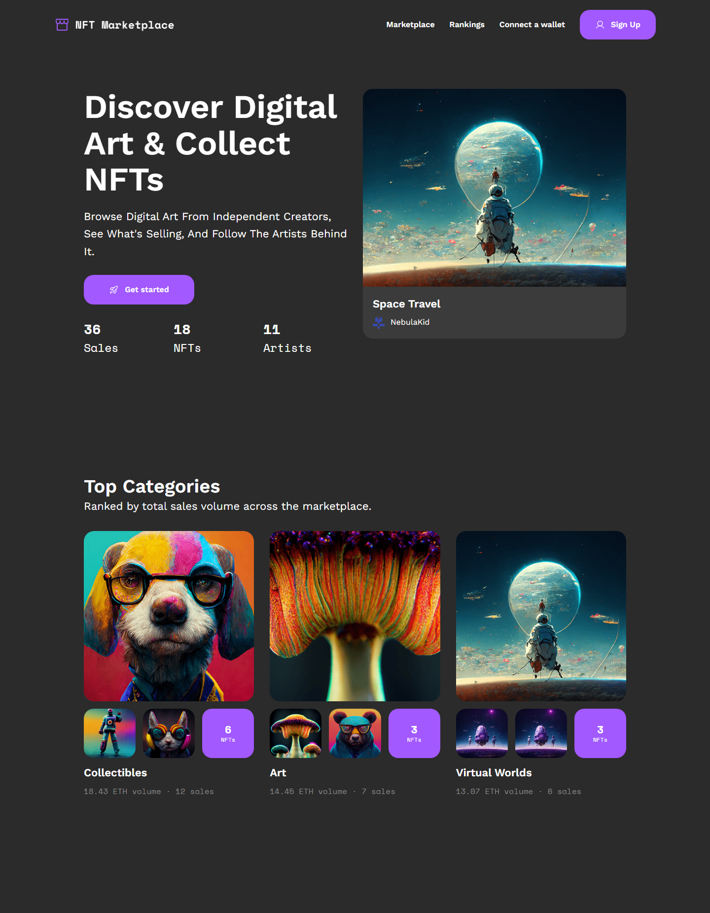
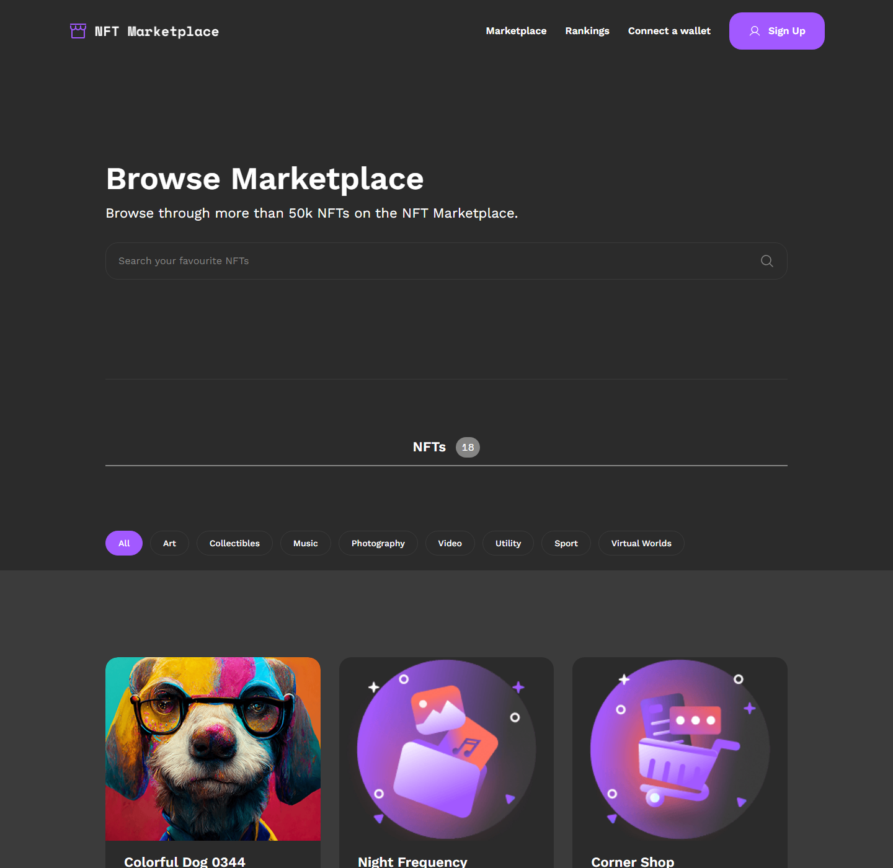
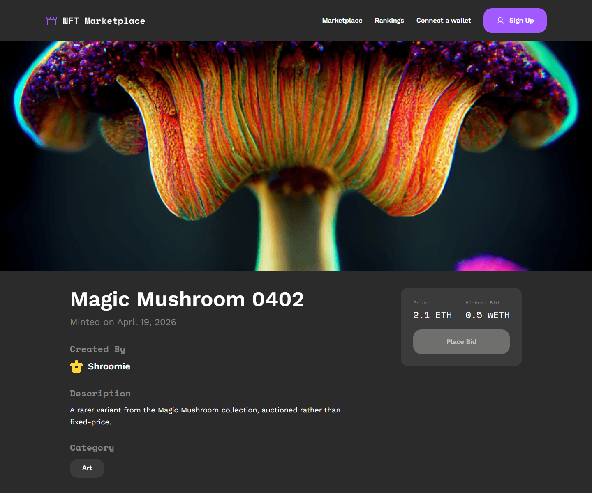
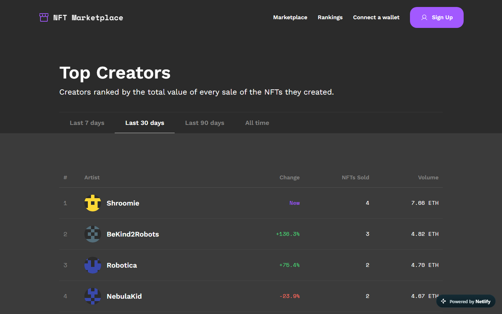

# NFT Marketplace


[](https://github.com/KomilovIslombek/nft-marketplace/actions/workflows/test.yml)


A full-stack NFT marketplace built from scratch: vanilla HTML/SCSS/JS on the
frontend, a Node.js/Express REST API on the backend, MongoDB for storage, and
JWT authentication (including Google OAuth). This is a personal portfolio
project, built and documented the way a production app would be.

**Live demo:** <https://komilov-nft-marketplace.netlify.app> (the API goes live with the Render step in [docs/DEPLOYMENT.md](docs/DEPLOYMENT.md))
· **Why it's built this way:** [docs/DECISIONS.md](docs/DECISIONS.md)

> Every number on the site comes from the database. There are no hardcoded
> "240k+ artists". The NFTs, creators and sale history are demo data
> generated by `npm run seed`; the code paths that read them are real.

| Homepage | Marketplace |
|---|---|
|  |  |
| **NFT page** | **Rankings** |
|  |  |

**Design reference:** the UI (Homepage, Marketplace, Artist Page, NFT Page,
Rankings, Connect Wallet, Create Account) follows a Figma community template:
[NFT Marketplace mockup](https://www.figma.com/design/rZrfOdLveTRirGv5bMojpp/NFT-Marketplace--Copy---Copy---Copy-).
Where the template showed features this app doesn't have, the UI was changed
to show real data or removed. See [Status](#status-whats-built-vs-not).

---

## Table of contents

- [Tech stack](#tech-stack)
- [Project structure](#project-structure)
- [Status: what's built vs. not](#status-whats-built-vs-not)
- [Getting started](#getting-started)
- [Running the tests](#running-the-tests)
- [Deployment](#deployment)
- [Environment variables](#environment-variables)
- [API reference](#api-reference)
- [Roadmap](#roadmap)

---

## Tech stack

**Frontend**
- Static HTML5 pages, no framework or bundler
- SCSS, compiled to `assets/css/main.css` with the `sass` CLI. The compiled CSS is committed, so production needs no build step.
- Vanilla JavaScript (ES6+, `fetch`). One shared `config.js` decides where the API lives.

**Backend**
- Node.js + [Express 5](https://expressjs.com/)
- [MongoDB](https://www.mongodb.com/) via [Mongoose](https://mongoosejs.com/), including aggregation pipelines for rankings and trending
- Auth: JWT in an `httpOnly`, `SameSite=Strict` cookie (email/password + Google sign-in via `google-auth-library`)
- Passwords hashed with `bcrypt`

**Testing & CI**
- Integration tests with Node's built-in test runner (`node:test`) + [supertest](https://github.com/ladjs/supertest), against an in-memory MongoDB ([mongodb-memory-server](https://github.com/typegoose/mongodb-memory-server))
- GitHub Actions runs them on every push

**Hosting (free tier)**
- Frontend: [Netlify](https://www.netlify.com/), which also proxies `/api/*` to the backend
- Backend: [Render](https://render.com/) web service ([`render.yaml`](render.yaml) Blueprint)
- Database: [MongoDB Atlas](https://www.mongodb.com/atlas) M0

## Project structure

```
nft-marketplace/
├── back/                         # Express REST API
│   ├── config/db.js              # MongoDB connection
│   ├── controllers/
│   │   ├── auth.controller.js    # register / login / Google OAuth / me / logout / change password
│   │   ├── nft.controller.js     # NFT listing CRUD
│   │   ├── user.controller.js    # public profile lookup (GET /api/users/:id)
│   │   ├── ranking.controller.js # creator leaderboard aggregated from Sale docs
│   │   ├── trending.controller.js# most traded NFTs / top categories (homepage)
│   │   └── stats.controller.js   # marketplace totals (homepage hero)
│   ├── middleware/
│   │   └── auth.middleware.js    # verifies the JWT cookie, attaches req.user
│   ├── modules/                  # Mongoose schemas: user.js, nft.js, sale.js
│   ├── routes/                   # /api/auth, /api/nfts, /api/users, /api/rankings, /api/trending, /api/stats
│   ├── utils/
│   │   ├── generatetoken.js      # signs JWTs
│   │   ├── periods.js            # shared ?period= windows (7d/30d/90d/all)
│   │   └── seed.js               # demo creators + NFTs + generated sale history (`npm run seed`)
│   ├── tests/                    # integration tests (node:test + supertest + in-memory MongoDB)
│   ├── .env.example              # template for your local .env
│   ├── app.js                    # builds the Express app (no DB, no listen); used by the tests
│   └── server.js                 # entry point: connect to MongoDB, then listen
│
├── front/                        # Static frontend
│   ├── assets/
│   │   ├── css/                  # compiled output (generated from scss/)
│   │   ├── scss/                 # source styles (abstracts / components / layout / pages)
│   │   ├── js/                   # page scripts + shared layout/auth logic; config.js = API location
│   │   └── images/, icons/
│   ├── index.html                # Homepage
│   ├── login.html, register.html, profile.html
│   ├── marketplace.html          # browse / search / filter all NFTs (#category=Art pre-selects a filter)
│   ├── nft.html                  # single NFT, reached via #id=<mongoId>
│   ├── artist.html               # creator profile, reached via #id=<mongoId>
│   ├── rankings.html             # Top Creators leaderboard (#period=all opens a tab)
│   └── connect-wallet.html       # wallet provider picker (honestly non-functional)
│
├── docs/
│   ├── DEPLOYMENT.md             # step-by-step free-tier deploy guide
│   ├── DECISIONS.md              # the key design decisions and their trade-offs
│   └── screenshots/
├── netlify.toml                  # frontend hosting + /api proxy to Render
├── render.yaml                   # backend hosting (Render Blueprint)
└── .github/workflows/test.yml    # CI: backend tests on every push
```

## Status: what's built vs. not

The Figma mockup defines 7 page types (each with desktop/tablet/mobile
variants): **Homepage, Create Account, Artist Page, NFT Page, Connect Wallet,
Marketplace, Rankings**. All of them are implemented.

**Built:**
- ✅ **Homepage** (`index.html`). Every section runs on live data:
  - **Hero stats** (sales, NFTs, artists) from `GET /api/stats`. The **hero card** is a real NFT and links to it.
  - **Top Categories**: the Figma "Trending Collection" card layout, filled with real categories ranked by sales volume (`GET /api/trending/categories`). The app has no collections model, so it ranks the grouping the data really has.
  - **Top Creators** from `GET /api/rankings`, the same endpoint as the Rankings page, so the two can't disagree
  - **Discover More NFTs** from `GET /api/nfts`
  - **Spotlight**: the Figma "Auction" banner, now showing the most traded NFT with its real sale count and volume (`GET /api/trending/nfts`). The fake countdown is gone.
  - **Browse Categories** tiles link to the Marketplace with that category pre-selected
- ✅ **Register / Login**: email + password, and "Sign in with Google"
- ✅ **Profile** (logged-in only), including change password
- ✅ Auth state synced across pages via the `httpOnly` cookie (the nav switches between guest and logged-in)
- ✅ **Marketplace**: debounced search, category chips, "Load more" pagination, and loading / empty / error states
- ✅ **NFT detail page**: image, artist, description, category, price and highest bid, "more from this artist"
- ✅ **Artist page**: real stats (NFTs created, NFTs owned, listed value), bio, Created / Owned tabs
- ✅ **Rankings**: `7d` / `30d` / `90d` / `all` tabs, each a separate server query on a different `soldAt` window. The Change column tells "no previous period" (`—`) apart from "no sales last period" (`New`) instead of showing a fake 0%.
- ✅ **Connect Wallet**: real, clickable UI that says plainly there's no Web3 integration
- ✅ **Backend API**: auth, NFT CRUD with owner-only edit/delete, public profiles, rankings, trending, stats (see [API reference](#api-reference))
- ✅ **`Sale` model**: the event that moves an NFT's `owner`, so "Created" and "Owned" really differ. It's the source of every volume figure.
- ✅ **35 backend integration tests**, run on every push by GitHub Actions
- ✅ **Production setup**: Netlify + Render + Atlas config, a CORS allowlist, secure cookies behind a same-origin proxy, cold-start handling ([docs/DEPLOYMENT.md](docs/DEPLOYMENT.md))

**Deliberately not built (honest gaps, not bugs):**
- **No buy/checkout flow, so no sale is ever created by a user action.** The `Sale` model and everything that aggregates it are real code paths; the sales in the database come from `npm run seed` (fixed random seed, so every run produces the same history). Demo content, real mechanism.
- No live bidding: the NFT page shows the highest bid, but "Place Bid" is disabled rather than pretending to work
- No collections or auctions: neither has a model, so neither appears anywhere in the UI ([why](docs/DECISIONS.md#1-no-fake-data-on-screen))
- No Web3 wallet integration: Connect Wallet is UI only and says so
- No newsletter: the "weekly digest" forms say plainly that nothing was sent or stored
- No wallet address, Follow button or social links on the Artist page, since there's no real data behind them
- No form for creating listings yet. `POST /api/nfts` exists and is tested, but has no UI.

## Getting started

### Prerequisites

- [Node.js](https://nodejs.org/) 20.19+ (developed on 24)
- A [MongoDB Atlas](https://www.mongodb.com/atlas) cluster (or local MongoDB)
- A [Google OAuth client ID](https://console.cloud.google.com/apis/credentials) if you want "Sign in with Google" to work

### 1. Backend

```bash
cd back
npm install
cp .env.example .env   # then fill in your own values, see below
npm run dev             # http://localhost:5000, restarts on change (nodemon)
npm run seed            # optional: demo creators, 18 NFTs, generated sale history
```

### 2. Frontend

From the repo root, serve `front/` and keep the SCSS compiler running:

```bash
npx serve front -l 5501
npx sass --watch front/assets/scss/main.scss:front/assets/css/main.css --style=expanded --no-source-map
```

Then visit `http://127.0.0.1:5501/index.html`.

> In development, `front/assets/js/config.js` calls the API on port 5000 of
> the same hostname, and the backend's CORS accepts the usual local dev ports
> (5500/5501/5502/3000).

## Running the tests

```bash
cd back
npm test
```

35 integration tests (auth, NFT list/search/CRUD, rankings, trending, stats)
run against the real Express app and a throwaway in-memory MongoDB. They never
touch your real database and need no `.env`. The first run downloads a MongoDB
binary (about 100 MB), which is cached afterwards. GitHub Actions runs the same
suite on every push ([workflow](.github/workflows/test.yml)).

## Deployment

Free tier: **Netlify** (static frontend + `/api` proxy) → **Render** (Express
API) → **MongoDB Atlas**. The proxy keeps the `SameSite=Strict` auth cookie
first-party, so login works in every browser, Safari included, without
loosening the cookie settings.

The step-by-step guide (accounts, environment variables, seeding, Google OAuth
origins, troubleshooting) is in **[docs/DEPLOYMENT.md](docs/DEPLOYMENT.md)**.

## Environment variables

All variables are documented in [`back/.env.example`](back/.env.example):

| Variable | Description |
|---|---|
| `MONGODB_URI` | MongoDB connection string, including the database name |
| `JWT_SECRET` | Secret used to sign auth tokens |
| `GOOGLE_CLIENT_ID` | From Google Cloud Console, for "Sign in with Google". No client secret is needed: the backend only verifies ID tokens. |
| `FRONTEND_URL` | Production only: allowed CORS origin(s), comma-separated |
| `NODE_ENV` | `development` or `production`. Controls the cookie `Secure` flag, the CORS mode and `trust proxy`. |
| `PORT` | API server port (defaults to `5000`; Render sets its own) |
| `DNS_SERVERS` | Optional: resolvers for the `mongodb+srv` lookup (development defaults to 1.1.1.1 / 8.8.8.8) |
| `DEMO_PASSWORD` | Optional, local only: password for the seeded demo creators (random if unset) |

## API reference

Base URL: `http://localhost:5000/api` locally, `/api` on the deployed site.

| Method | Endpoint | Auth required | Description |
|---|---|---|---|
| GET | `/health` | No | Health check |
| POST | `/auth/register` | No | Create an account (username, email, password) |
| POST | `/auth/login` | No | Log in with email + password |
| POST | `/auth/google` | No | Log in / sign up with a Google ID token |
| GET | `/auth/me` | Yes | Get the current logged-in user |
| POST | `/auth/logout` | No | Clear the auth cookie |
| PUT | `/auth/change-password` | Yes | Change password (local accounts only) |
| GET | `/nfts` | No | List NFTs. Query params: `search`, `category`, `creator`, `owner`, `page`, `limit` (default 12) |
| GET | `/nfts/:id` | No | Get one NFT |
| POST | `/nfts` | Yes | Create an NFT listing (creator + owner = you) |
| PUT | `/nfts/:id` | Yes | Update an NFT (current owner only) |
| DELETE | `/nfts/:id` | Yes | Delete an NFT (current owner only) |
| GET | `/users/:id` | No | Public profile (username, avatarUrl, bio), never email or password |
| GET | `/rankings` | No | Creator leaderboard by sales volume. Query params: `period` (`7d`/`30d`/`90d`/`all`, default `30d`), `limit` (default 20, max 50) |
| GET | `/trending/nfts` | No | NFTs ranked by sales volume, with `sales`, `volume`, `lastSoldAt`. Query params: `period` (as above), `limit` (default 5, max 20) |
| GET | `/trending/categories` | No | Categories ranked by sales volume, each with `nftCount` and up to 3 `previews`. Query params: `period`, `limit` (default 3, max 8) |
| GET | `/stats` | No | Marketplace totals: `nfts`, `creators` (users with at least one listing), `sales`, `volume` |

How rankings are calculated (a sale is credited to the NFT's **creator**, also
on resales) is explained in [back/README.md](back/README.md#how-rankings-are-calculated).

## Roadmap

- [x] NFT data model + CRUD API
- [x] Marketplace page on the real API
- [x] NFT detail page
- [x] Artist profile pages
- [x] Wallet connect flow (UI only, no Web3 integration)
- [x] Sale/transaction model + creator rankings API
- [x] Rankings page
- [x] Homepage on real data: Top Creators, Discover More, hero stats, Top Categories (instead of "Trending Collection"), Spotlight (instead of "Auction")
- [x] Backend integration tests + CI
- [x] Production setup (Netlify + Render + Atlas) and deploy guide
- [x] Frontend live on Netlify: https://komilov-nft-marketplace.netlify.app
- [ ] Backend on Render + database on Atlas, following [docs/DEPLOYMENT.md](docs/DEPLOYMENT.md)

Possible next steps:
- [ ] A "create listing" form for `POST /api/nfts`, with image URL validation or upload
- [ ] A buy flow that creates real `Sale` documents
- [ ] Rate limiting on the auth endpoints

---

## License

MIT, see [LICENSE](LICENSE).
